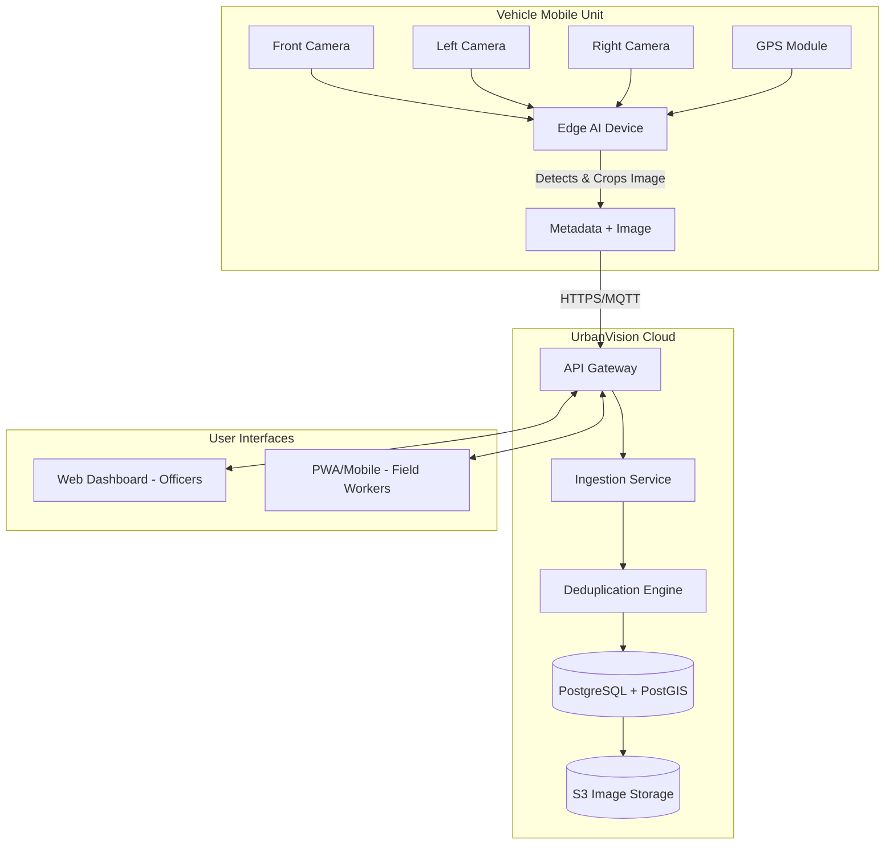

# System Design & Structure - UrbanVision

## 1. High-Level Architecture

The system follows a distributed Edge-to-Cloud architecture.

## 2. Database Schema (PostgreSQL + PostGIS)
*   **`Issues`**: `id`, `category` (Pothole/Garbage/Drain), `status` (Open/Assigned/Resolved), `location` (Point geometry), `image_url`, `severity`, `created_at`.
*   **`Vehicles`**: `id`, `license_plate`, `ward_assigned`, `last_active`.
*   **`Tasks`**: `id`, `issue_id` (FK), `worker_id` (FK), `assigned_by`, `status`, `resolved_image_url`, `completed_at`.
*   **`Workers`**: `id`, `name`, `phone`, `assigned_ward`.
*   **`PerformanceLogs`**: `id`, `worker_id`, `tasks_completed`, `average_resolution_time`.

## 3. Tech Stack Choices
*   **Edge AI:** NVIDIA Jetson Nano/Orin, Python, OpenCV, YOLOv8, DeepStream.
*   **Backend:** Node.js (NestJS or Express) for API, Python for deduplication microservice.
*   **Database:** PostgreSQL with PostGIS extension for geospatial queries. Prisma ORM.
*   **Frontend (Dashboard):** React 18, TypeScript, Tailwind CSS, Mapbox GL JS / Deck.gl.
*   **Frontend (Worker):** Progressive Web App (PWA) using React.
*   **Communication:** REST APIs for CRUD operations; WebSocket for real-time map updates when a new issue is detected.