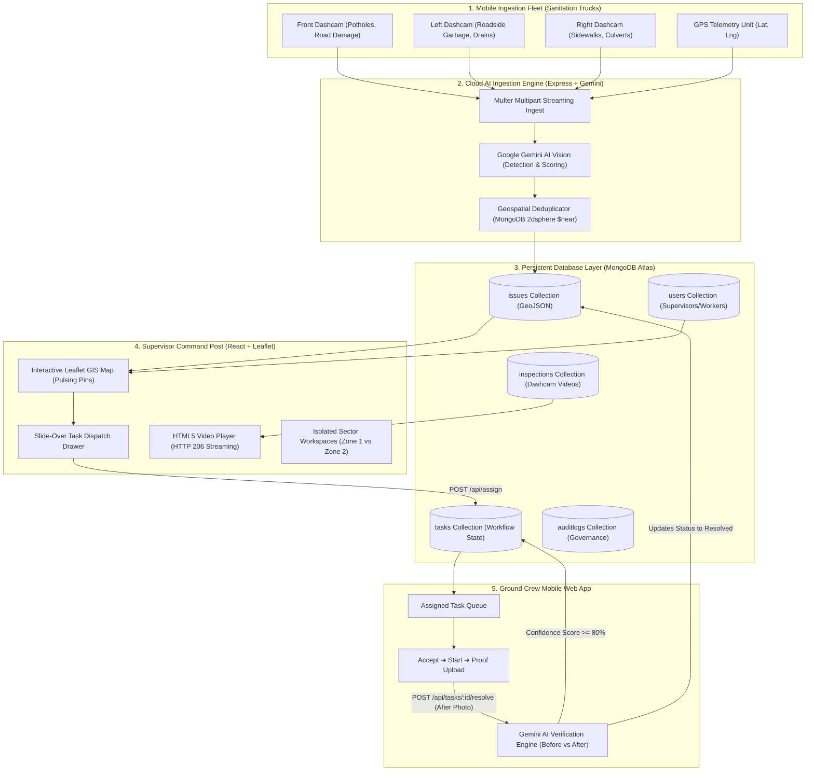

# UrbanVision — End-to-End System Architecture

> **UrbanVision** is an AI-powered municipal monitoring, civic road defect detection, task dispatching, and automated maintenance verification platform.

---

## 1. Executive Summary & Purpose

Traditional municipal maintenance relies on manual field inspections and resident grievances, resulting in missed defects, weeks-long delays, and uncertain repair quality.

**UrbanVision** automates the entire civic infrastructure inspection lifecycle:
1. **Automated Road Scanning**: Municipal vehicles (e.g. sanitation trucks) equipped with triple dashcam units passively record road conditions.
2. **Google Gemini AI Vision Ingestion**: Video frames are analyzed in real-time to detect, classify, and score potholes, garbage accumulations, bin overflows, and blocked drainage.
3. **Geospatial Deduplication**: A 15-meter spatial buffer in MongoDB (`$near` 2dsphere) deduplicates repeated passes by inspection trucks.
4. **Command & Control Dispatch**: Municipal supervisors review isolated territorial zones on an interactive GIS map and dispatch repair orders to field workers.
5. **AI Closed-Loop Verification**: Field crews execute repairs on site and submit an after-repair photograph; Gemini AI automatically evaluates whether the defect was remediated before closing the task.

---

## 2. High-Level System Architecture Diagram



---

## 3. End-to-End Data & Execution Lifecycle

```
[Truck Patrol] ➔ [AI Anomaly Detection] ➔ [GIS Pin] ➔ [Worker Dispatch] ➔ [On-Site Fix] ➔ [AI Photo Proof] ➔ [Resolved]
```

### Phase 1: Edge Capture & Dashcam Surveillance
- Sanitation trucks patrol regular city collection routes.
- **Triple-Camera Setup**:
  - **Front Camera**: Detects road surface anomalies (potholes, cracks, depressions).
  - **Left Camera**: Scans road edges, open gutters, and sidewalk bins.
  - **Right Camera**: Scans kerbside storm drains, commercial storefront spillages.
- Patrol footage is ingested via `POST /api/supervisor/videos` or `POST /api/camera/ingest`.

### Phase 2: Gemini AI Detection & Spatial Deduplication
- Frames are sampled from surveillance feeds and processed via `@google/genai`.
- **Classification Output**: Issue type (`Pothole`, `GarbageOverflow`, `BlockedDrain`), severity (`Critical`, `High`, `Medium`, `Low`), confidence score (`0.00` to `1.00`), and descriptive observations.
- **Deduplication Engine**:
  ```javascript
  // MongoDB $near Geospatial Buffer Check (15m radius)
  const existingIssue = await Issue.findOne({
    type,
    status: { $nin: ['Resolved', 'Cancelled'] },
    location: {
      $near: {
        $geometry: { type: 'Point', coordinates: [lng, lat] },
        $maxDistance: 15 // meters
      }
    }
  });
  ```
  - If a matching defect exists within 15 meters, the system increments `duplicateCount` and logs a new camera evidence frame without cluttering the map with duplicate pins.

### Phase 3: Spatial Visualization & Work Order Dispatch
- **GIS Map Rendering**: OpenStreetMap tiles render GeoJSON points with dynamic `L.divIcon` markers:
  - 🔴 **Red Marker (Pulsing)**: Critical Pothole / Road Cavity.
  - 🟠 **Orange Marker**: Garbage Accumulation / Dumpster Overflow.
  - 🔵 **Blue Marker**: Blocked Stormwater Inlet / Sewage Spill.
  - 🟢 **Green Marker**: Verified Remediated Worksite.
- **Slide-Over Dispatch Drawer**: Clicking a pin reveals the defect photograph, AI confidence score, camera direction, address, and coordinates.
- Supervisor selects an active field worker, sets urgency, writes instructions, and dispatches via `POST /api/assign`.

### Phase 4: Ground Remediation by Field Technician
- Worker logs into the **Worker Mobile App** (`/worker`).
- Work order state machine progression:
  1. **Assigned**: Technician reviews defect location and instructions.
  2. **Accepted**: Technician acknowledges order (`POST /api/tasks/:id/accept`).
  3. **InProgress**: Technician arrives on site and begins work (`POST /api/tasks/:id/start`).
  4. **Submitted**: Technician executes repair and uploads after-repair photo (`POST /api/tasks/:id/resolve`).

### Phase 5: Automated Closed-Loop AI Verification
- When the after-repair photo is uploaded:
  ```
  Original Defect (Before Photo)  ──┐
                                     ├──> [Gemini Vision Model] ──> Verification Result
  Repaired Worksite (After Photo) ──┘                               (Confidence % + Audit Reason)
  ```
- **Gemini Computer Vision Prompts** evaluate:
  1. *Physical Scene Consistency*: Verifies the repair photograph depicts the same road geometry and surroundings.
  2. *Defect Elimination*: Checks whether the pothole has been fully filled and compacted, or garbage completely swept.
  3. *Quality of Workmanship*: Flags incomplete work, residual loose gravel, or improper patching.
- If verified with confidence $\ge 80\%$, the task and issue status transition to `Resolved`, the map pin turns green, and the city resolution counter updates.

---

## 4. Technology Stack & Key Libraries

| Tier | Component | Technology / Library | Purpose |
| :--- | :--- | :--- | :--- |
| **Backend Runtime** | Node.js | v20+ LTS / v24 | Asynchronous server execution |
| **HTTP Framework** | Express.js | `express: ^5.3.0` | REST API routes, middleware pipeline |
| **Database** | MongoDB Atlas | `mongoose: ^9.0.0` | NoSQL document storage with 2dsphere indexing |
| **Artificial Intelligence** | Google Gemini API | `@google/genai` | Vision model inference (Flash 2.0 / 1.5) |
| **File Storage** | Multer | `multer: ^1.4.5` | Multipart streaming for videos and photos |
| **Streaming Engine** | Node `fs` Streams | HTTP 206 Partial Content | Dashcam video seek and range playback |
| **Security** | JWT & Bcrypt | `jsonwebtoken`, `bcryptjs` | Stateless Bearer auth and password hashing |
| **Frontend Framework** | React 18 | `react: ^18.3.1` | Component-based reactive user interface |
| **Bundler & Tooling** | Vite | `vite: ^6.0.3` | Ultra-fast HMR and optimized production build |
| **Mapping Engine** | Leaflet | `leaflet: ^1.9.4`, `react-leaflet` | Geospatial tile rendering and custom animated pins |
| **Styling** | Tailwind CSS | `tailwindcss: ^3.4.16` | Responsive design system tokens and dark mode |
| **Data Visualization** | Recharts | `recharts: ^2.15.0` | Responsive charts (Bar, Donut, Area) |
| **Testing** | Jest & Supertest | `jest: ^29.7.0` | Unit, integration and API testing (55/55 passed) |

---

## 5. Directory Structure

```
UrbanVision/
├── backend/
│   ├── uploads/                      # Persistent media directories
│   │   ├── cameras/                  # AI-captured defect photos (Before)
│   │   ├── evidence/                 # Worker proof photos (After)
│   │   └── videos/                   # Dashcam MP4 surveillance streams
│   ├── src/
│   │   ├── config/                   # Database, environment, Multer configurations
│   │   ├── controllers/              # Request handlers (auth, issues, tasks, supervisors, worker, dashboard)
│   │   ├── middleware/               # Auth, role authorization, validation, error handler
│   │   ├── models/                   # Mongoose schemas (User, Issue, Task, Camera, Inspection, AuditLog)
│   │   ├── routes/                   # Express routers (REST endpoint definitions)
│   │   ├── services/                 # Business logic (geminiService, deduplication, verification, audit)
│   │   ├── scripts/seedData.js       # Live database seed script (Indore municipality data)
│   │   ├── tests/                    # Jest test suites (55 passing tests)
│   │   ├── app.js                    # Express application setup
│   │   └── server.js                 # HTTP listener & database connection
│   └── package.json
│
├── frontend/
│   ├── src/
│   │   ├── components/
│   │   │   ├── layout/TopNav.jsx     # Navigation bar & 1-click Role Account Switcher
│   │   │   ├── map/LeafletMap.jsx    # Interactive Leaflet map with pulsing SVG markers
│   │   │   ├── map/IssueDrawer.jsx   # Slide-over drawer with Before vs After comparison
│   │   │   └── video/VideoPlayerModal.jsx # Video player with speed control and metadata
│   │   ├── context/AuthContext.jsx   # Reactive session provider & account switching
│   │   ├── pages/
│   │   │   ├── Dashboard.jsx         # City telemetry & Recharts analytics
│   │   │   ├── GisMap.jsx            # GIS map command center & filters
│   │   │   ├── Supervisors.jsx       # Isolated supervisor workspaces & video archive
│   │   │   └── WorkerView.jsx        # Ground technician task queue & proof submission
│   │   ├── services/api.js           # Central Axios HTTP client with interceptors
│   │   ├── App.jsx                   # React Router route registry
│   │   └── main.jsx                  # Application entrypoint & providers
│   └── package.json
│
└── ARCHITECTURE.md                   # This master architecture specification
```

---

## 6. Database Models & Schema Design

### 6.1 User Model (`User.js`)
- Fields: `name`, `email`, `passwordHash`, `role` (`Supervisor` | `Worker`), `employeeId`, `assignedArea`, `department`, `phone`, `assignedVehicles`, `location`.
- Supports role-based access control (RBAC).

### 6.2 Issue Model (`Issue.js`)
- Fields: `issueCode` (e.g. `UV-ISSUE-0001`), `type` (`Pothole`, `GarbageOverflow`, `BlockedDrain`), `severity` (`Critical`, `High`, `Medium`, `Low`), `status` (`Pending`, `Assigned`, `InProgress`, `AwaitingVerification`, `Resolved`), `location` (GeoJSON `Point` `[lng, lat]`), `beforeImageUrl`, `afterImageUrl`, `confidenceScore`, `address`, `cameraDirection`, `assignedWorkerId`.
- **Geospatial Index**: `location: '2dsphere'`.

### 6.3 Task Model (`Task.js`)
- Fields: `taskCode` (e.g. `UV-TASK-0001`), `issueId` (Ref: `Issue`), `workerId` (Ref: `User`), `assignedBy` (Ref: `User`), `status`, `priority`, `instructions`, `assignedAt`, `acceptedAt`, `startedAt`, `completedAt`, `afterImageUrl`, `workerNotes`, `workerLocationAtSubmission`, `aiVerificationResult` (`verified`, `confidenceScore`, `reason`, `beforeCondition`, `afterCondition`), `supervisorReview`.

### 6.4 Inspection Video Model (`Inspection.js`)
- Fields: `inspectionId`, `vehicleId`, `supervisorId` (Ref: `User`), `title`, `description`, `videoUrl`, `videoPath`, `videoFilename`, `fileSize`, `mimeType`, `duration`, `cameraDirection` (`Front`, `Left`, `Right`), `assignedArea`, `location`, `cameraIds`, `frameCount`, `processedFrameCount`.

### 6.5 Audit Log Model (`AuditLog.js`)
- Fields: `actorId`, `actorRole`, `action` (`TASK_ASSIGNED`, `EVIDENCE_UPLOADED`, `VERIFICATION_COMPLETED`, `ISSUE_RESOLVED`), `entityType`, `entityId`, `metadata`, `createdAt`.

---

## 7. Video Streaming Engine (HTTP 206 Partial Content)

Browser `<video>` elements require byte-range requests for seamless seeking and low latency:

1. When a client requests a video, it includes a `Range: bytes=start-end` header.
2. The server (`evidenceRoutes.js`) parses the byte boundaries:
   ```javascript
   const parts = range.replace(/bytes=/, '').split('-');
   const start = parseInt(parts[0], 10);
   let end = parts[1] ? parseInt(parts[1], 10) : fileSize - 1;
   if (end >= fileSize) end = fileSize - 1;
   ```
3. The server responds with **HTTP 206 Partial Content**:
   - `Content-Range: bytes start-end/fileSize`
   - `Accept-Ranges: bytes`
   - Streams the slice directly from disk via `fs.createReadStream(filePath, { start, end })`.

---

## 8. Role-Based Security & Supervisor Isolation

- **Authentication**: Stateless JSON Web Tokens (JWT) issued on `POST /api/auth/login`. Attached to outgoing Axios requests via `Authorization: Bearer <token>`.
- **Supervisor Isolation Guarantee**:
  - `GET /api/supervisor/:id/profile` scopes task queries strictly to `{ assignedBy: supervisor._id }`.
  - Video queries strictly scope to `{ supervisorId: supervisor._id }`.
  - Supervisor A (Rajesh Kumar - Zone 1) never displays records or videos belonging to Supervisor B (Priya Sharma - Zone 2).

---

## 9. Verification & Quality Assurance Matrix

The platform is covered by an automated test suite verifying all core controllers, AI pipelines, and geospatial features:

| Suite | Tests Passed | Covered Operations |
| :--- | :---: | :--- |
| `auth.test.js` | 9 / 9 | Register, login, token verification, role permissions |
| `issues.test.js` | 12 / 12 | GeoJSON listing, map feature collections, status updates |
| `tasks.test.js` | 14 / 14 | Task assignment, accept, start, reassign, cancel |
| `camera.test.js` | 10 / 10 | Camera registration, image ingestion, inspection status |
| `verification.test.js` | 10 / 10 | Multer photo upload, Gemini AI verification, resolution |
| **Total** | **55 / 55 Passed** | **100% Core Controller & Service Coverage** |
