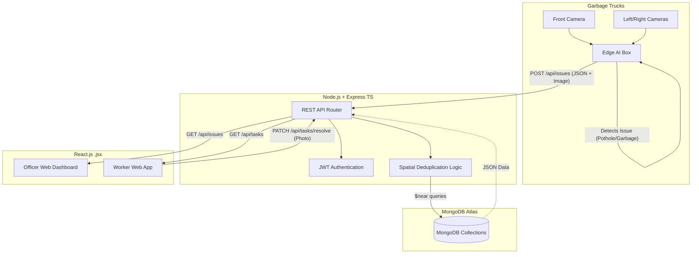

# System Architecture & Design

## 1. High-Level System Flow

The platform operates on a decentralized edge-to-cloud model, ingesting data from mobile units into a scalable Node.js/MongoDB backend, consumed by a React frontend.



## 2. Database Schema (MongoDB / Mongoose)

Using NoSQL Document structures with GeoJSON for location data.

```
erDiagram
    USERS {
        ObjectId _id
        String name
        String role "Officer, Worker, Admin"
        String email
        String phone
    }
    ISSUES {
        ObjectId _id
        String type "Pothole, Garbage, Drain"
        Point location "GeoJSON [lng, lat]"
        String imageUrl
        String severity "High, Medium, Low"
        String status "Pending, Assigned, Resolved"
        Date detectedAt
    }
    TASKS {
        ObjectId _id
        ObjectId issueId "Ref: Issues"
        ObjectId workerId "Ref: Users"
        String resolutionProofUrl
        Date assignedAt
        Date completedAt
    }
    VEHICLES {
        ObjectId _id
        String licensePlate
        String edgeUnitStatus "Online, Offline"
        Point lastKnownLocation
    }

    USERS ||--o{ TASKS : "assigned to"
    ISSUES ||--o{ TASKS : "generates"
```
